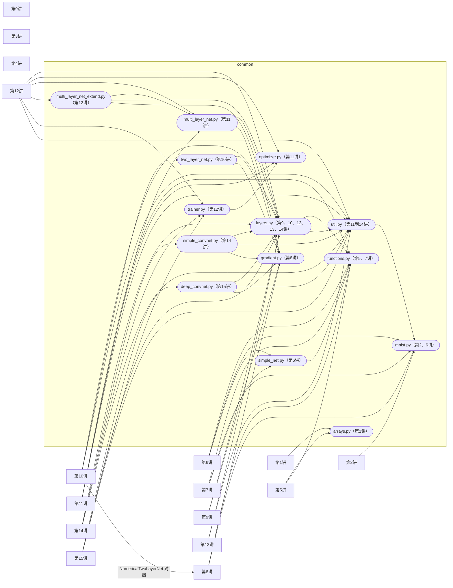

# 讲次与 common 模块的依赖关系

后面的讲次复用前面已经写好的东西：前面讲里实现、后面还要用的函数和类都放在 common/，后面的讲次直接 import。
本文件的依赖关系是用脚本扫描各讲 .py 里的 `from common... import` 和 `from lectureNN... import` 生成的（扫描时间 2026-11-15，14:25 鱼书对齐后重新扫描过），以实际 import 为准。
第0讲到第8讲的部分是执行员C 按 import 扫出来的初稿，标「B 补充」的地方留给执行员B 补充说明。

## 依赖图

箭头 A --> B 表示 A 用到了 B。方框是讲次，圆角框是 common 里的模块，括号里是它最早出现的讲次。

## common 模块一览

| 模块 | 内容 | 首次出现 | 负责人 | 对应鱼书源码 |
|---|---|---|---|---|
| arrays.py | describe、matmul_steps | 第1讲 | B | B 补充 |
| functions.py | identity、step_function、sigmoid、sigmoid_grad、relu、softmax、mean_squared_error、cross_entropy_error | 第5讲、第7讲 | B | B 补充 |
| mnist.py | load_mnist（下载并缓存到 dataset/）、to_one_hot | 第2讲、第6讲 | B | B 补充 |
| simple_net.py | init_network、predict（第6讲的推理网络） | 第6讲 | B | B 补充 |
| gradient.py | numerical_diff、numerical_gradient、gradient_descent | 第8讲 | B | B 补充 |
| layers.py | MulLayer、AddLayer（第9讲）；Relu、Sigmoid、Affine、SoftmaxWithLoss（第10讲）；BatchNormalization、Dropout（第12讲）；Convolution、Pooling（第13、14讲） | 第9讲 | C | common/layers.py（MulLayer、AddLayer 对应 ch05/layer_naive.py） |
| two_layer_net.py | TwoLayerNet（反向传播版，构造参数和键名与第8讲 NumericalTwoLayerNet 相同） | 第10讲 | C | ch05/two_layer_net.py |
| optimizer.py | SGD、Momentum、Nesterov、AdaGrad、RMSprop、Adam、make_optimizer | 第11讲 | C | common/optimizer.py |
| multi_layer_net.py | MultiLayerNet、init_scale（Xavier、He） | 第11讲 | C | common/multi_layer_net.py |
| multi_layer_net_extend.py | MultiLayerNetExtend（BN、Dropout 开关） | 第12讲 | C | common/multi_layer_net_extend.py |
| trainer.py | Trainer | 第12讲 | C | common/trainer.py |
| util.py | im2col、col2im、conv_output_size（第13、14讲）；shuffle_dataset（第12讲）；smooth_curve、get_mnist、toy_digits、is_quick、get_pyplot（训练脚本共用） | 第11讲起 | C | common/util.py（get_mnist、toy_digits、is_quick、get_pyplot 是本仓库加的） |
| simple_convnet.py | SimpleConvNet | 第14讲 | C | ch07/simple_convnet.py |
| deep_convnet.py | DeepConvNet | 第15讲 | C | ch08/deep_convnet.py |

## 每讲用到的前面模块

| 讲次 | 用到的前面模块（括号里是这些东西出自哪一讲） |
|---|---|
| 第0讲 | 无（只用 NumPy）。B 补充 |
| 第1讲 | common/arrays.py 的 describe、matmul_steps（本讲新增）。B 补充 |
| 第2讲 | common/mnist.py（读一张手写数字画图）。B 补充 |
| 第3讲 | 无（只用 Pandas）。B 补充 |
| 第4讲 | 无。B 补充 |
| 第5讲 | common/arrays.py 的 matmul_steps（第1讲）；common/functions.py 的 step_function、sigmoid、relu（本讲新增）。B 补充 |
| 第6讲 | common/functions.py 的 identity、sigmoid、softmax（第5讲及本讲）、cross_entropy_error；common/mnist.py 的 load_mnist；common/simple_net.py（本讲新增）。B 补充 |
| 第7讲 | common/functions.py 的 cross_entropy_error、mean_squared_error（本讲新增）；common/mnist.py；common/simple_net.py 的 init_network、predict（第6讲）。B 补充 |
| 第8讲 | common/functions.py 的 sigmoid、softmax、cross_entropy_error（第5、7讲）；common/gradient.py（本讲新增）；common/mnist.py。B 补充 |
| 第9讲 | common/gradient.py 的 numerical_diff、numerical_gradient（第8讲）；新增 common/layers.py 的 MulLayer、AddLayer |
| 第10讲 | common/functions.py 的 sigmoid、softmax、cross_entropy_error（第5、7讲，经层内部调用）；common/gradient.py 的 numerical_gradient（第8讲）；lecture08/numerical_two_layer_net.py 的 NumericalTwoLayerNet（第8讲，梯度确认对照）；common/mnist.py（经 get_mnist）；新增 Relu、Sigmoid、Affine、SoftmaxWithLoss 和 TwoLayerNet |
| 第11讲 | common/functions.py 的 sigmoid、relu（第5讲）；common/layers.py 的 Affine、Relu、Sigmoid、SoftmaxWithLoss（第10讲，经 MultiLayerNet）；common/gradient.py（第8讲）；新增 optimizer.py、MultiLayerNet |
| 第12讲 | common/layers.py 的 Affine、Relu、SoftmaxWithLoss（第10讲）；common/optimizer.py 的 SGD、common/multi_layer_net.py 的 MultiLayerNet 和 init_scale（第11讲）；common/gradient.py（第8讲，测试）；新增 BatchNormalization、Dropout、MultiLayerNetExtend、Trainer、shuffle_dataset |
| 第13讲 | 第10讲的层接口；提前用第14讲的 im2col、conv_output_size、Convolution、Pooling 核对朴素循环的结果 |
| 第14讲 | common/layers.py 的 Affine、Relu、SoftmaxWithLoss（第10讲）；common/optimizer.py 的 Adam（第11讲）；common/trainer.py 的 Trainer（第12讲）；第13讲的卷积原理和示例数据；新增 im2col、col2im、Convolution、Pooling、SimpleConvNet |
| 第15讲 | common/layers.py 的 Affine、Relu、SoftmaxWithLoss（第10讲）、Dropout（第12讲）、Convolution、Pooling（第13、14讲）；common/optimizer.py 的 Adam（第11讲）；common/trainer.py（第12讲）；common/util.py 的 im2col（第14讲）；新增 DeepConvNet |

## 与鱼书源码的对应（第9讲到第15讲）

鱼书官方源码是 MIT 许可（Copyright (c) 2016 Koki Saitoh）。改编自鱼书的文件在头部注释里写明了来源；类名、函数名、构造参数和层的命名尽量与原书一致。

| 讲次 | 对应鱼书 | 本仓库补充的脚本（书中没有对应源码文件） |
|---|---|---|
| 第9讲 | 第5章 ch05/layer_naive.py、buy_apple.py、buy_apple_orange.py | chain_rule.py |
| 第10讲 | 第5章 ch05/two_layer_net.py、gradient_check.py、train_neuralnet.py | activation_layers.py、affine_layer.py、softmax_loss_grad.py |
| 第11讲 | 第6章 ch06/optimizer_compare_naive.py、optimizer_compare_mnist.py、weight_init_activation_histogram.py、weight_init_compare.py | zero_init.py |
| 第12讲 | 第6章 ch06/batch_norm_test.py、batch_norm_gradient_check.py、overfit_weight_decay.py、overfit_dropout.py、hyperparameter_optimization.py | batchnorm_steps.py、dropout_demo.py |
| 第13讲 | 第7章 7.1到7.3节（无单独源码文件） | 全部 |
| 第14讲 | 第7章 ch07/simple_convnet.py、gradient_check.py、train_convnet.py、visualize_filter.py、apply_filter.py | im2col_demo.py、conv_pool_layers.py、lenet_alexnet.py |
| 第15讲 | 第8章 ch08/deep_convnet.py、train_deepnet.py、misclassified_mnist.py、half_float_network.py | receptive_field.py、data_augmentation.py、_trained.py |

## 约定
- 后面讲次 import 的一律是 common 里的版本。个别讲里保留了「从零写一遍」的教学演示（例如第10讲把 sigmoid 拆成四个节点的 sigmoid_by_nodes，第13讲的朴素循环卷积 conv2d_loops、max_pool_loops，第6讲的 naive_softmax），只在本讲使用，各讲 README 里有说明。
- 训练脚本统一用 common/util.py 的 get_mnist 取数据（内部调用 common/mnist.py 的 load_mnist，下载失败时换成合成数据并打印提示），用 is_quick 判断 QUICK=1。
